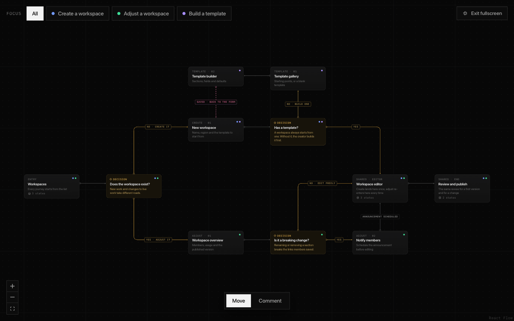

# Auis UX Flow

An agent skill that maps **several user journeys of your product on one board**. Screens the journeys share are drawn once, with one dot per journey, and a lens per journey dims everything else.

A normal flow diagram shows one path. This shows where paths meet, where they split, and which screens carry more than one of them.



**[Open the live demo](https://gregoriombp.github.io/auis-ux-flow/)** · [watch it cycle the lenses](https://gregoriombp.github.io/auis-ux-flow/?tour=1)

Works in any repository and any stack. Nothing is installed in your project: the agent writes data files, and a single HTML file renders them. Open it with a double-click.

## Install

With the [skills CLI](https://github.com/vercel-labs/skills) (Claude Code, Codex, Cursor and others):

```bash
npx skills add gregoriombp/auis-ux-flow
```

As a Claude Code plugin:

```text
/plugin marketplace add gregoriombp/auis-ux-flow
/plugin install auis-ux-flow@auis-ux-flow
```

Or copy [`skills/auis-ux-flow`](skills/auis-ux-flow) into your project's `.claude/skills/` (Claude Code) or `.agents/skills/` (Codex, Cursor).

## Use

Ask your agent, in your own repository:

```text
Map sign-up, invite and checkout as a UX flow.
```

```text
Compile "create a workspace" and "adjust an existing workspace" into one flow.
```

The agent reads your routes and screens, works out which screens the journeys share, and writes:

```
ux-flows/
  index.html        the viewer (one file, no dependencies)
  flows.js          which flows to show
  <slug>.flow.js    the flow: scenarios, cards, edges, changelog
```

Open `ux-flows/index.html`. Commit the folder; publish it anywhere static if you want to share the map.

## What you get

- **Shared screens, drawn once.** A card with two or more dots is one screen used by several journeys.
- **A lens per journey.** Pick one: everything outside it dims, and a band frames its path.
- **Real screens one click away.** A card opens the running screen in a side panel, with one tab per state (empty, loading, error) when those states have URLs.
- **Gates and convergences made explicit.** Decisions are their own cards; the places where journeys rejoin are the cards with the most dots.
- **Notes that go back to the agent.** Leave notes on cards in Comment mode, drag cards where you want them, then **Copy for agent** and paste: the agent updates the flow and its changelog.
- **A changelog** of structural changes, kept in the flow file.
- Fullscreen, light and dark, and deep links: `index.html#/checkout?focus=guest`.

## Keeping a flow up to date

```text
Add the gift-card journey to the checkout flow.
```

```text
<paste the block from "Copy for agent">
```

The skill classifies the change, edits the flow file, adds a changelog entry and runs the validator.

## How it works

| Piece | What it does |
|---|---|
| [`SKILL.md`](skills/auis-ux-flow/SKILL.md) | The method: read the product, do the merge analysis, lay out lanes, write the flow, validate. |
| [`assets/viewer.html`](skills/auis-ux-flow/assets/viewer.html) | The viewer, built into one file. It loads flows through script tags, so it runs from disk (`file://`) without a server. |
| [`scripts/validate.mjs`](skills/auis-ux-flow/scripts/validate.mjs) | Checks a `ux-flows/` folder with no dependencies: broken references, a card cut off from its lens, an edge no lens can light, overlapping cards. The viewer runs the same rules and shows what it finds. |
| [`references/`](skills/auis-ux-flow/references) | The [flow file format](skills/auis-ux-flow/references/flow-format.md) and the [layout guide](skills/auis-ux-flow/references/layout.md). |

Run the validator yourself:

```bash
node path/to/skills/auis-ux-flow/scripts/validate.mjs ux-flows
```

## Limits

- Card positions are chosen by the agent and adjustable by drag. There is no auto-layout.
- Screen previews need your app running at the flow's `baseUrl`, and an app that allows being embedded. When it does not, the panel's "Open in a new tab" still works.
- Screens behind a login open signed out in the panel when the viewer is opened from disk: browsers do not send an app's session to a page embedded from elsewhere. Serve `ux-flows/` from the app itself (its public or static folder) to preview them signed in.
- Notes and dragged positions live in your browser until you copy them to the agent.
- The validator needs Node 18 or newer. The viewer needs only a current browser.

## Part of Auis

This skill is one piece of [Auis](https://github.com/gregoriombp/AuisDesign), a toolkit for designing product UI with coding agents: design-system skills, in-page review comments, live edits, and a State Mode that gives every screen state a URL. If the flow is useful, the rest is built the same way.

## Development

```bash
cd viewer
npm install
npm run dev      # the viewer with the demo flow from docs/
npm run build    # rebuilds skills/auis-ux-flow/assets/viewer.html and docs/index.html
node --test ../tests/*.test.mjs
```

`docs/` is the live demo: the built viewer, the example flow and its mock screens.

## License

MIT
